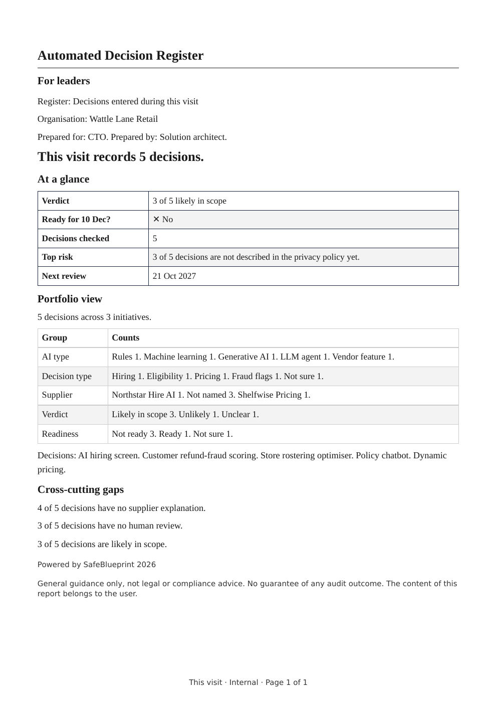
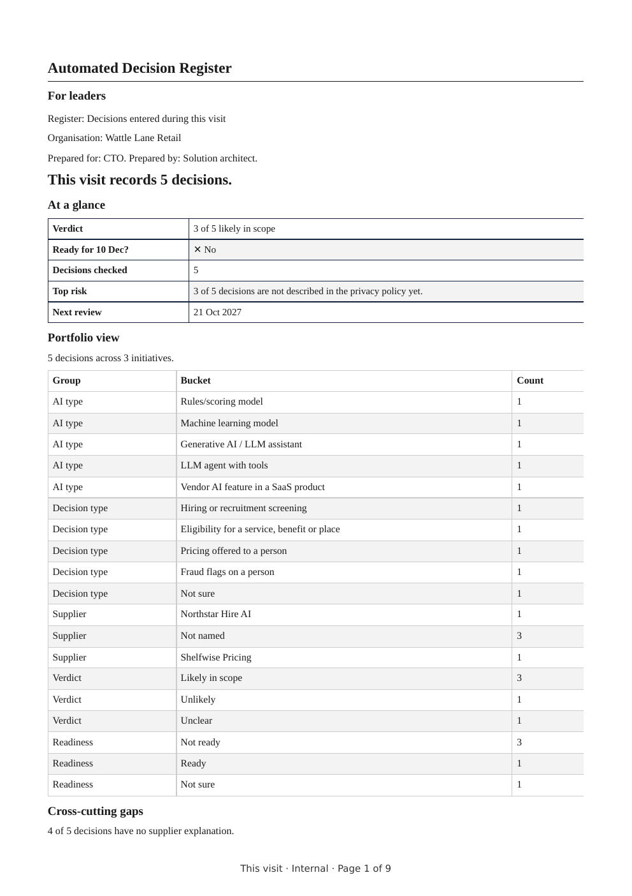
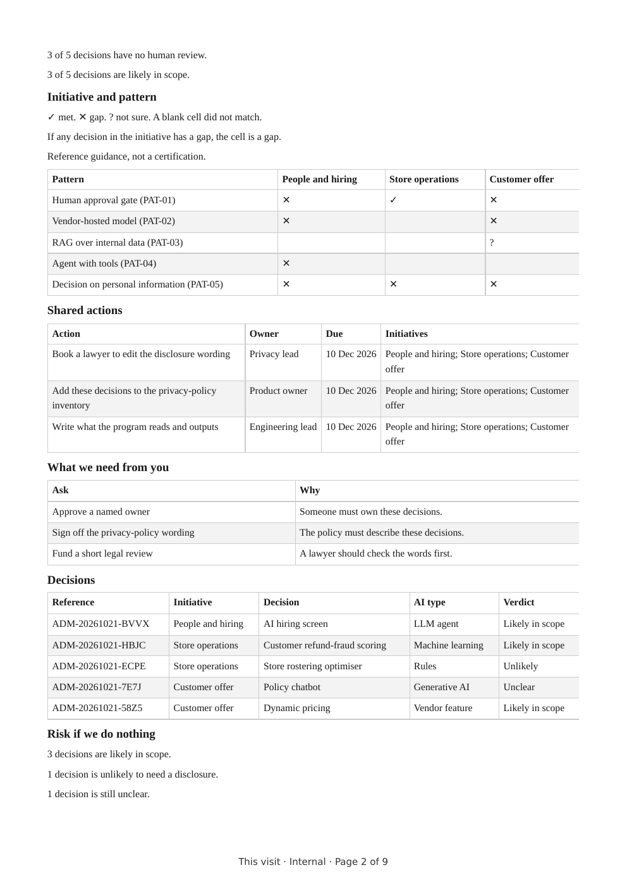
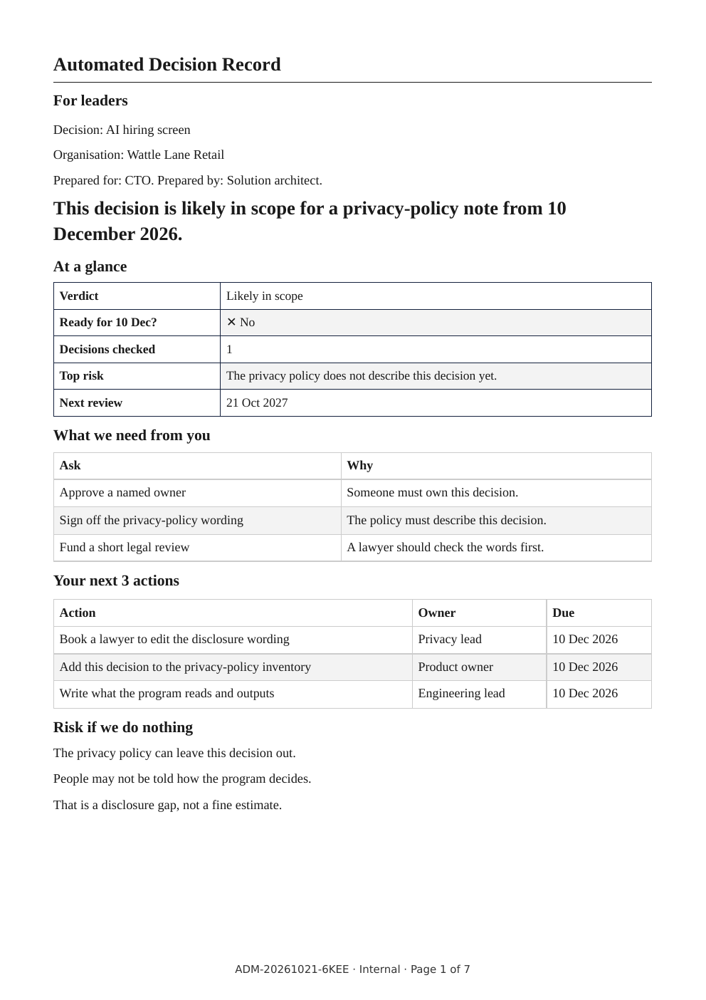
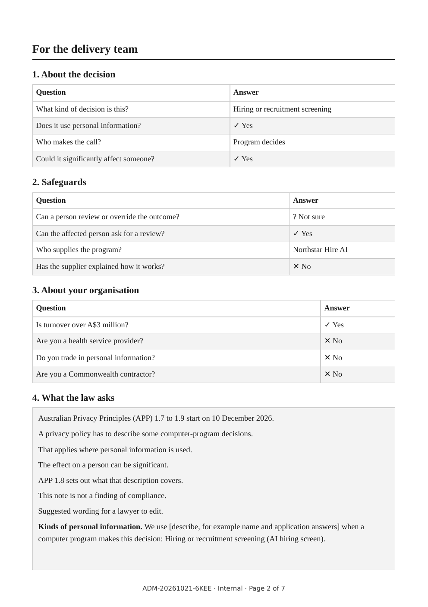
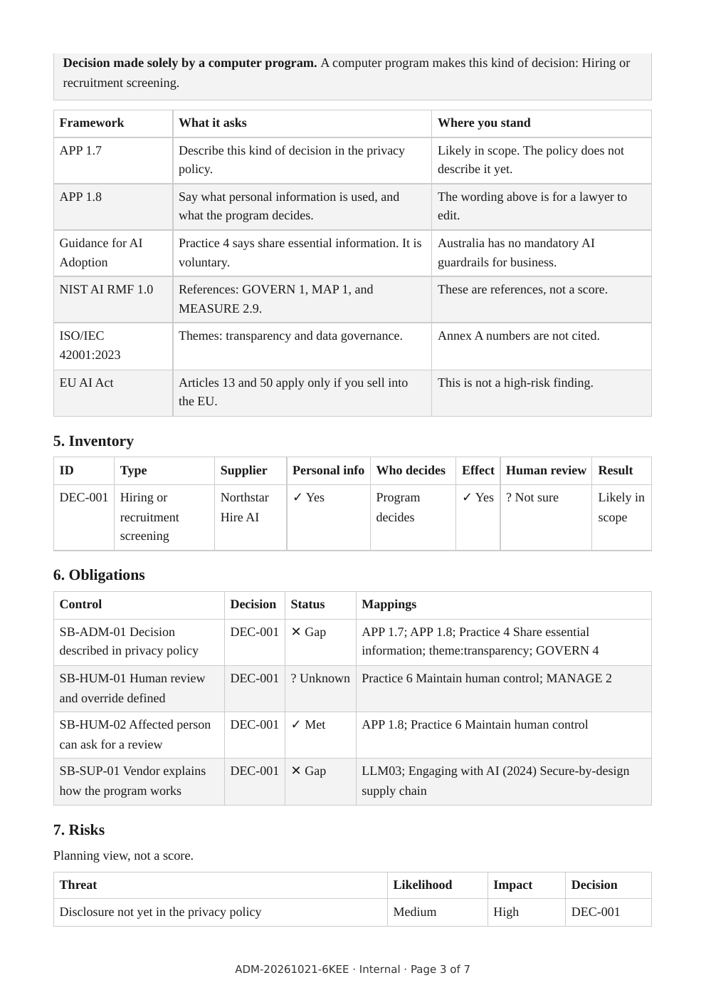

# SafeBlueprint Community Edition

[](https://github.com/goloviproducts-coder/safeblueprint-community/actions/workflows/codeql.yml) [](https://scorecard.dev/viewer/?uri=github.com/goloviproducts-coder/safeblueprint-community) [](https://github.com/goloviproducts-coder/safeblueprint-community/actions/workflows/checksums.yml)

Free, self-hostable AI decision-readiness and AI security checklist. **Everything runs on your device**: no accounts, no tracking, no external calls, nothing you type leaves the browser unless you choose to save an export.

Hosted version: https://safeblueprint.pages.dev

## What it does
- **APP 1.7 automated-decision readiness** - prepare for the Privacy Act transparency duties for automated decisions using personal information.
- **AI security checklist** - mapped to OWASP LLM Top 10 (2025), MITRE ATLAS, NIST AI RMF, ISO/IEC 42001 themes, the Australian Guidance for AI Adoption and ASD guidance.
- **Three-part report**: A - For leaders (one-minute page 1), B - For the delivery team, C - For security architects (pattern match).
- **Portfolio view** - group decisions across initiatives by AI type.
- Exports to PDF, JSON (schema in `site/schema/report/`) and Markdown, ready to feed into GRC or AI tools.

## Quick start
```bash
npx serve site                 # local, http://localhost:3000
docker compose up -d           # Docker + nginx, see INSTALL.md
```
Or copy `site/` to any static host (intranet, S3, Azure Static Web Apps). Serve from the site root. Verify integrity with `sha256sum -c SHA256SUMS.txt`. Details: [INSTALL.md](INSTALL.md).

## Screenshots
| Leader summary (portfolio) | Portfolio report p1 | Portfolio report p2 |
|---|---|---|
|  |  |  |

| Single initiative p1 | p2 | p3 |
|---|---|---|
|  |  |  |

Full sample (fictional company): [docs/samples/sample-portfolio.pdf](docs/samples/sample-portfolio.pdf)

## Contributing
We welcome bug reports, framework mapping updates, new security patterns, wording fixes and translations. Read [CONTRIBUTING.md](CONTRIBUTING.md) and our [Code of Conduct](CODE_OF_CONDUCT.md). Look for `good first issue`.

## Security scans
Every PR runs: checksum + no-outbound-calls check, CodeQL (JavaScript and Actions), Semgrep, Gitleaks (full history), Trivy (config + filesystem), dependency review, zizmor (workflow linting) and HTML validation. Lighthouse runs report-only. OpenSSF Scorecard runs on `main` weekly. All actions are pinned to commit SHAs with least-privilege permissions. An optional AI security review runs when a maintainer adds the `security-review` label; it is **off until an `ANTHROPIC_API_KEY` secret is added**.

## Security
See [SECURITY.md](SECURITY.md). Please don't open public issues for vulnerabilities.

## Not legal advice
SafeBlueprint is a readiness aid, not legal advice. You own your content and outputs; check obligations with a qualified adviser.

## License
Apache-2.0 - see [LICENSE](LICENSE).
