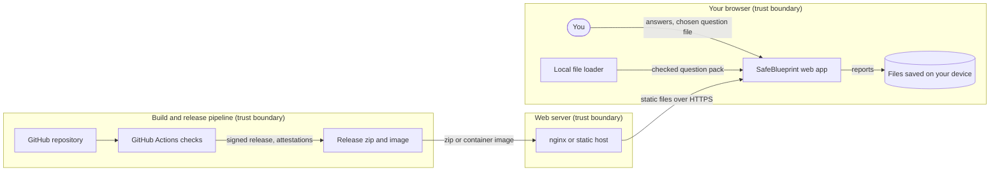

# Threat model

SafeBlueprint is a free tool that runs entirely in your web browser. This page explains what could go wrong and what we do about it, in plain English first. The detailed register for auditors is further down. The machine-readable copy is [docs/threat-model/safeblueprint.json](docs/threat-model/safeblueprint.json) (OWASP Threat Dragon v2; open it at https://www.threatdragon.com or in the desktop app). **Keep both in sync.**

## In plain English
| What could go wrong | How likely / serious | What we do about it |
|---|---|---|
| Your answers leave your computer | Unlikely / Serious | The tool has no server, no analytics and no tracking. The browser is told to block any connection to other websites, and automated tests check on every change that nothing is sent anywhere. |
| A booby-trapped question file or answer runs harmful code | Unlikely / Serious | Everything you type or load is treated as plain text, never as code. The browser only runs our own scripts, and each one is checked against a fingerprint. |
| A huge or broken question file freezes the page | Possible / Minor | Question files are capped in size and length, and read in a simple way that can't get stuck. |
| A downloaded report contains something nasty, like a spreadsheet formula | Unlikely / Moderate | Exports are cleaned before saving so spreadsheet and web content can't trigger anything. |
| Someone passes off a fake or modified copy of the tool | Possible / Moderate | Every release is signed, fingerprinted and comes with a list of exactly what's inside, so anyone can check they have the real thing. |
| A web server hosting the tool is set up weakly or tampered with | Possible / Moderate | We ship ready-made secure server settings and a hardened container, and scan them for known weaknesses. |
| Our build and release pipeline is hijacked to ship bad code | Unlikely / Serious | Every change needs the maintainer's approval and passes security scans. Build tools are locked to exact versions, secrets are never exposed to outside contributions, and production only gets reviewed, signed releases after staging works. |
| A risky change slips in without anyone thinking about security | Possible / Moderate | An automatic check spots risky changes on every pull request and makes sure this page gets a matching entry before it can merge. |
| Secrets such as passwords or keys get committed by mistake | Unlikely / Serious | Secret scanning blocks pushes that contain them, and the whole history is scanned too. |
| Contact details sent through the website reach the wrong place (hosted site only) | Unlikely / Moderate | The contact relay only accepts messages from our own site, sends them to one fixed inbox through a single email provider, limits each field and hides email addresses in its logs. The self-hosted edition has no relay at all. |

Likelihood and seriousness reflect the protections already in place.

## How data moves
Dashed boxes are trust boundaries: anything crossing one is checked.

## Scope and assumptions
- The app is static HTML/JS. There is no backend, account or database in the self-hosted edition; the contact relay is disabled. In the hosted edition, if the relay is unavailable the contact page shows plain links to Instagram and GitHub Issues (no extra network calls; no email address is shown).
- All answers and question packs stay in the visitor's browser. Nothing is sent unless a future feature asks for explicit consent.
- Out of scope: the visitor's own device security, and how users store or share exported files.

## Trust boundaries
| Boundary | Contains | Crosses it |
|---|---|---|
| Browser | Web app, local file loader, exports | User input, chosen pack files, saved files |
| Self-host server | nginx or another static host | Static files served to browsers |
| CI/CD supply chain | GitHub repo, Actions, releases | Third-party actions, base images, release assets |

## Recent changes in plain English
New entries in the detailed register get a one-line summary here (`npm run threat-model:update` adds it).
- **T22**: This change changes how our automated build and checks run; it also changes the outside code libraries or build commands we use; it also changes how releases are built or deployed (`.githooks/pre-push`, `.github/workflows/threat-model-gate.yml`, `package.json`, `scripts/threat-model-draft.js`, `scripts/threat-model-gate.js`, `test/threat-model-gate.test.js`). The detailed entry below says what could go wrong and how it is handled. _(auto-drafted)_

## Detailed register (for auditors)
STRIDE threats and mitigations.
| ID | Element | STRIDE | Threat | Severity | Mitigation | Controls | Status |
|---|---|---|---|---|---|---|---|
| T01 | SafeBlueprint web app (browser) | Tampering | Script injection via answers or pack text | High | All user and pack text is set with textContent or escaped (esc()); no eval; CSP script-src 'self' with SRI on every script. | OWASP-ASVS-5.3, CWE-79 | Mitigated |
| T02 | SafeBlueprint web app (browser) | Information disclosure | Answers leave the device | High | No analytics or third-party loads; CSP default-src/connect-src 'self'; CI verify job and ZAP baseline check for outbound calls. | APP1.7, APP11, OWASP-LLM02 | Mitigated |
| T03 | SafeBlueprint web app (browser) | Spoofing | Look-alike or modified copy of the tool | Medium | Signed releases, SLSA provenance and SBOM attestations; SHA256SUMS; SRI hashes. | SLSA-L2, ASD-E8-APPCTRL | Mitigated |
| T04 | SafeBlueprint web app (browser) | Denial of service | Very large or deeply nested pack freezes the tab | Low | 1 MB file limit, 500 question limit, 2000 character cell limit; parser is linear with no recursion. | CWE-400 | Mitigated |
| T05 | Local file loader (question packs) | Tampering | Malicious pack content (HTML, formulas, javascript: URLs) | Medium | Pack text only rendered via textContent; links are never created from pack data; strict field validation with row/column errors. | CWE-79, CWE-1236 | Mitigated |
| T06 | Local file loader (question packs) | Repudiation | Unclear which pack produced a report | Low | Report document control shows pack name, version and SHA-256 of the exact file. | ISO42001-7.5 | Mitigated |
| T07 | Local file loader (question packs) | Elevation of privilege | Pack loaded from another origin via config | Medium | Only same-site paths matching a strict pattern are fetched; CSP connect-src 'self'. | CWE-918 | Mitigated |
| T08 | Exports (PDF, HTML, JSON, Markdown, CSV) | Tampering | Formula injection in CSV exports | Medium | formulaSafe() prefixes risky cells with an apostrophe. | CWE-1236 | Mitigated |
| T09 | Exports (PDF, HTML, JSON, Markdown, CSV) | Information disclosure | Saved reports contain sensitive answers | Medium | Classification label on every page; user owns content; files never leave the device unless the user shares them. | APP11, ISO42001-A.7 | Accepted |
| T10 | Exports (PDF, HTML, JSON, Markdown, CSV) | Tampering | Markdown/HTML injection in exported files | Low | Markdown cells escape backslashes and pipes; HTML export serialises DOM built with textContent. | CWE-116 | Mitigated |
| T11 | Self-host server (nginx / static host) | Information disclosure | Missing security headers | Medium | nginx.conf and site/_headers set CSP, HSTS, X-Frame-Options, nosniff, Referrer-Policy, Permissions-Policy, COOP/CORP. | OWASP-ASVS-14.4, ASD-E8-HARDEN | Mitigated |
| T12 | Self-host server (nginx / static host) | Tampering | Modified files on the server | Medium | SHA256SUMS.txt and SRI; verify with sha256sum -c; container runs read-only static content. | ASD-E8-APPCTRL | Mitigated |
| T13 | Self-host server (nginx / static host) | Elevation of privilege | Vulnerable base image | Medium | Image pinned by digest; Dependabot docker updates; Trivy scan on PR. | ASD-E8-PATCH | Mitigated |
| T14 | CI/CD (GitHub Actions) | Tampering | Compromised third-party action | High | All actions pinned to full SHAs; allowed-actions list; SHA pinning required; harden-runner egress audit; zizmor lint; read-only default token. | SLSA-L2, OWASP-CICD-SEC-8 | Mitigated |
| T15 | CI/CD (GitHub Actions) | Elevation of privilege | Untrusted PR code with secrets | High | No pull_request_target; persist-credentials false; fork workflow approval for external contributors; AI review only for same-repo PRs. | OWASP-CICD-SEC-4 | Mitigated |
| T16 | CI/CD (GitHub Actions) | Spoofing | Unverified commits or tags | Medium | Signed commits required on main; tag ruleset restricts v* to admins and the release deploy key (Deploy keys bypass); approve-release tags are SSH-signed and checked against .github/release-signers; provenance attestations. | SLSA-L2 | Mitigated |
| T17 | CI/CD (GitHub Actions) | Repudiation | Security-sensitive change without review | Medium | Threat-model gate (run from the base branch) classifies each PR by content; risk-relevant changes need a threat row added in the same PR that names every risk-relevant file (written by `npm run threat-model:update`, checked by a pre-push hook; Dependabot manifest-only updates are covered by the dependency scans), and the maintainer's PR approval is the sign-off; a generated inventory of flows, endpoints, headers and workflow permissions must match the code (read-only CI, never pushes to PR branches); CODEOWNERS; 1 approval and conversation resolution. | ISO42001-8.1 | Mitigated |
| T18 | Source repository | Information disclosure | Secrets committed | Medium | Secret scanning with push protection; Gitleaks full-history scan. | CWE-798 | Mitigated |
| T19 | Contact function (hosted only) | Information disclosure | Contact details sent to a third party or leaked in logs | Medium | Resend only; recipient and key from Pages env (CONTACT_TO, RESEND_API_KEY); 503 when unset; origin allow-list; strict field limits; emails redacted in logs; self-host edition has no function. | APP11, OWASP-ASVS-14.4 | Mitigated |
| T20 | CI/CD deploy | Elevation of privilege | Unreviewed code deployed to production | High | Deploy production only from signed vX.Y.Z tags on main (PR + required checks); production environment needs maintainer approval; secrets scoped to the environment; pinned wrangler-action; smoke tests after deploy; setup-node package cache disabled in the deploy job to prevent cache poisoning; production contact function accepts only the pages.dev origins (no localhost). | SLSA-L2, OWASP-CICD-SEC-1 | Mitigated |
| T20a | CI/CD staging deploy | Elevation of privilege / Information disclosure | Code reaches the public staging URL, or staging is indexed and mistaken for production | Medium | Staging is the first job of `deploy.yml` (own concurrency group, so a production deploy waiting for approval never blocks it), runs only on pushes to `main` (PR + required checks), signed `v*` tags or manual dispatch, and deploys only to the `staging` Pages branch alias (`--branch staging`), never the production branch; same pinned actions, harden-runner, read-only permissions and disabled package cache as production; X-Robots-Tag noindex added to the staging build only; smoke tests after deploy. Production deploys only from verified release tags, after staging succeeds and a maintainer approves. | SLSA-L2, OWASP-CICD-SEC-1 | Mitigated |
| T20b | CI/CD PR previews | Information disclosure / Elevation of privilege | A PR deploy leaks the Cloudflare token or ships attacker code under the project domain | Medium | `preview.yml` runs on `pull_request` only (never `pull_request_target`), only when the head repo is this repo and not for Dependabot, so fork PRs never run it or get secrets; the build step has no secrets in its environment; deploys only to a `pr-<number>` alias, never production; noindex header; job token limited to contents:read, deployments and PR comments. Residual: anyone who can push a branch here (write access) can run code beside the token, which is the same trust as merge rights. | OWASP-CICD-SEC-4, OWASP-CICD-SEC-6 | Mitigated |
| T20c | CI/CD release and rollback | Tampering / Spoofing | An unsigned, forged or off-main tag is released or deployed, or a rollback changes main | High | Production deploys only from `vX.Y.Z` tags; `release.yml`, `deploy-production` and `rollback.yml` verify through the GitHub API that the tag is annotated, GitHub-verified and points at a commit on `main`; the `v*` tag ruleset allows only admins; tags are signed locally by the maintainer (CI holds no signing key); the maintainer-only Release gate (`release` environment, actor check) checks main HEAD is verified and the CHANGELOG was promoted; rollback is read-only on git, checks out exactly the tag commit, verifies SHA256SUMS and needs production approval. | SLSA-L2, OWASP-CICD-SEC-1, OWASP-CICD-SEC-9 | Mitigated |
| T20d | CI/CD approve-to-release | Spoofing / Elevation of privilege | An unapproved or unchecked commit is tagged and deployed by the approve-release workflow, or the release deploy key is stolen or misused | High | `approve-release.yml` runs from `main` only; a read-only job checks CHANGELOG/VERSION/package.json, the allowed-signers file, that the tag is free and that main HEAD is GitHub-verified, and records that SHA; only the job in the `production` environment (maintainer approval) can read the `RELEASE_DEPLOY_KEY` environment secret; it confirms the approval and that the SHA is still on `main`, SSH-signs an annotated tag at exactly that SHA with a neutral identity, verifies it against the committed `.github/release-signers`, and pushes only that tag over SSH with the pinned github.com host key (StrictHostKeyChecking); the key lives in a 0600 temp file removed on exit and is never printed; the job token is read-only (contents: read, actions: read, deployments: write). The resulting push is skipped by the `source` job in `release.yml` and `deploy.yml`, so there is no duplicate release or deploy. The called release and rollback verify the SSH signature against allowed signers (GitHub cannot mark deploy-key signatures Verified). Approver and run URL go into the tag and release notes; provenance attestation kept. Changing `.github/release-signers` is risk-relevant and needs maintainer review. Residual: the v* ruleset bypass for Deploy keys lets any write deploy key create v* tags (only the release key should exist); a stolen key could push a tag, but signed-tag push paths skip or reject it and production still needs approval; rotate by replacing the key and the signers line. | SLSA-L2, OWASP-CICD-SEC-1, OWASP-CICD-SEC-5, OWASP-CICD-SEC-6 | Mitigated |
| T21 | CI/CD release build | Tampering | Release zip differs from the reviewed source | Medium | `scripts/build-release.sh` builds only from the git tree with SOURCE_DATE_EPOCH (commit time), sorted entries, fixed permissions and no extra attributes; `reproducible-build` check builds twice and compares hashes on every PR; the release job builds twice and fails on mismatch; anyone can rebuild and match SHA256SUMS (docs/VERIFY.md). | SLSA-L2 (reproducible build), OWASP-CICD-SEC-9 | Mitigated |
| T22 | CI/CD workflows; Dependencies; Build, release and deploy tooling | Tampering / Elevation of privilege; Tampering | Workflow or repository-control change weakens permissions, runs untrusted code or exposes secrets; A changed dependency or npm script brings in malicious or vulnerable code; Build or release tooling changes what is shipped (Threat-model gate itself; CI/CD workflows and permissions; Dependencies or npm scripts changed; Build, release and deploy scripts; files: `.githooks/pre-push`, `.github/workflows/threat-model-gate.yml`, `package.json`, `scripts/threat-model-draft.js`, `scripts/threat-model-gate.js`, `test/threat-model-gate.test.js`) | High | Actions pinned to SHAs, least-privilege job permissions, no pull_request_target, harden-runner; zizmor, CodeQL and the threat-model gate (run from the base branch) check every PR; maintainer approval required to merge.; Lockfile pinned and installed with npm ci; dependency-review, OSV-Scanner and Trivy run on every PR; dev-only tools never ship in the site; maintainer approval required to merge.; Reproducible-build check on every PR; releases built twice and compared; signed tags; staging before production. | OWASP-CICD-SEC-1, OWASP-CICD-SEC-4; OWASP-CICD-SEC-3; SLSA-L2, OWASP-CICD-SEC-9 | Auto-drafted for threat-model-auto-entry; reviewed with the PR |

## Verification
Mitigations above are tested continuously: property-based fuzzing (fast-check, a pinned dev-only dependency that never ships in the site) feeds random and hostile input to the pack loader, scoring and Markdown export; browser security tests (`test/security/`) prove malicious packs cannot run script or break reports, CSP violations fail the build, and full tool runs and exports make zero cross-origin requests. `npm run privacy-proof` lets anyone reproduce the zero-egress check for a full run, a custom pack run and every export. Nuclei and ZAP scan the served site; Nikto and header checks scan the self-host container. See CONTRIBUTING.md, "Penetration tests".

## When to update
Update this file **and** the Threat Dragon JSON when a change is risk-relevant: a new or changed data flow, external endpoint, form or input field, storage, CSP or headers, schema content, workflows or permissions, dependencies, nginx/Docker, the service worker or server function. `docs/threat-model/inventory.json` is regenerated from the code with `npm run threat-model`. The `threat-model-gate` check classifies each PR by content, passes cosmetic changes, and for risk-relevant changes for risk-relevant changes requires a threat row added in the same PR that names every risk-relevant file. `npm run threat-model:update` writes that row (and its plain-English line) automatically; the maintainer's PR approval is the sign-off. No label is needed (see CONTRIBUTING.md).

## Residual risks
- Exported reports can contain sensitive answers; users control where they go (accepted).
- Solo maintainer: PRs need the maintainer's approving review (no admin bypass on main).
- Approve-to-release tags are signed with a deploy key that GitHub cannot show as Verified; trust rests on .github/release-signers, the production approval record and build provenance (see T20d).

General guidance only, not legal advice.
